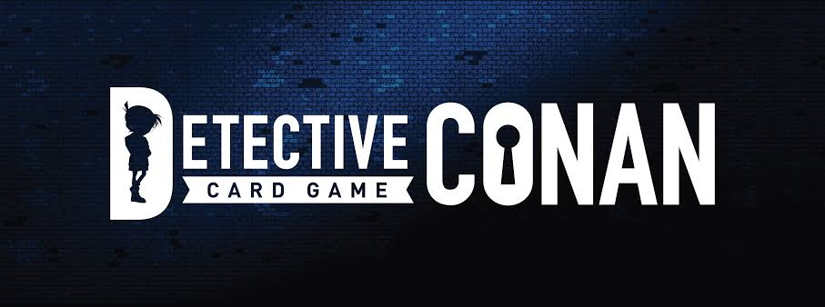

# 🕵️ Conan TCG Primer

<p align="center">
  
</p>

**An unofficial, beginner-friendly guide to the Detective Conan Trading Card Game by Takara Tomy.**

Learn the rules one small step at a time, watch a demo match, then play a simplified practice game against a bot, all in your browser and in **English or Vietnamese**.

<p align="center">
  <a href="https://github.com/ChuongQuoc1413017/Detective_Conan_Card_Game">
    
  </a>
  
  
  
</p>

---

## 📌 Overview

The **Detective Conan Trading Card Game (Conan TCG)** is a two-player card game. Players work with their Partner and characters to gather evidence and solve their case before their opponent does.

This primer is made for **children and first-time players**. Instead of one long page, it is split into short pages with a clear order, large buttons, a cute light brown brick theme, and extra detail folded away until you want it.

## 🚀 Getting Started

1. Open the [GitHub repository](https://github.com/ChuongQuoc1413017/Detective_Conan_Card_Game).
2. Download it (**Code → Download ZIP**) and unzip it, or clone it:

```bash
git clone https://github.com/ChuongQuoc1413017/Detective_Conan_Card_Game.git
```

3. Open `index.html` in a modern browser (Chrome, Firefox, Safari or Edge).

No installation, account or server is needed. Keep the whole folder together, because the pages share files and card images. An internet connection is only needed for the web fonts and external links.

When the site is served over http or https (for example with the command below, or on GitHub Pages), it also works **offline** and can be **installed** like an app from the browser menu. Pages are saved for offline use, and card images are saved the first time you see them.

If you prefer to use a local web server, run this inside the project folder and visit `http://localhost:8765`:

```bash
python3 -m http.server 8765
```

---

## 🗺️ Learning Path

| Step | Page | What you will do |
|---|---|---|
| Start | `index.html` | See how to win and choose where to go. |
| 1 | `board.html` | Meet the eight table areas, the four card types and the card states. |
| 2 | `turn.html` | Step through a turn, learn setup, and check which card levels you can play. |
| 3 | `actions.html` | Learn the Main phase moves, check whether you can win, and compare AP in a Contact. |
| 4 | `demo.html` | Watch a whole match, one step at a time. |
| 5 | `practice.html` | Play against the bot. |
| 6 | `quiz.html` | Test what you remember. |
| Anytime | `deck.html` | Search cards and build your own deck. |
| Anytime | `words.html` | Search the English and Japanese glossary (Vietnamese in VI mode). |
| Anytime | `about.html` | Contact the author. |

Use the **EN / VI** buttons in the top bar to change language. Your choice is remembered in your browser.

---

## ✨ Features

### 🎬 Demo Match

Follow one player from the opening hand to **“Case Solved!”** in 24 steps. The blue Conan deck plays against the black deck.

- Move with **Back**, **Next**, the arrow keys, or **Auto play**.
- Each step explains what happens in simple words.
- A glowing box shows what just changed on the table.

The demo is a teaching story: the card order is chosen in advance and some card effects are skipped.

### 🎮 Practice Game

Play a simplified match against a bot with three levels.

| Bot level | Difficulty | How it plays |
|---|---|---|
| Novice | Easy | Plays at random and often misses chances. |
| Sleuth | Normal | Plays its strongest cards and mostly gathers evidence. The default. |
| Master Sleuth | Hard | Attacks your evidence, picks off sleeping characters and guards with care. |

The bot never looks at your hand or either deck, and your chosen level is remembered in your browser.

- Choose one of six starter decks or your own deck from the Deck page, and pick the bot's deck or leave it random.
- **Own decks:** `assets/card-effects.js` reads each card's Japanese text. An ability runs only when every part of it is understood; otherwise it does nothing and the card is marked ⚠️. About 81% of printed abilities are covered, including Disguise, cards set on characters, face-up evidence, Investigate and many Case abilities. **MR cards** follow their rules from the Official Rule Manual (page 26): an MR that leaves the Scene during the opponent's turn moves to the Partner area, a new MR entering removes any MR already in your Scene or Partner area, and abilities marked as working in the Partner area can be used from there (it cannot deduce or take Actions there).
- Unavailable moves are greyed out, with the reason shown.
- Press **💡 Hint** during your turn to see what the Master Sleuth bot would do in your place, and why.
- Inspect cards, read the game log and view the Remove area.
- **🧪 Test my deck** plays your own deck against each starter deck 100 times (bot against bot) and shows the win rates. Only supported abilities are used, so treat it as a rough guide.

### 🧩 Puzzles

Short challenges on the Play page: the board is set up for you, and you must find the moves that solve the case in one turn. Each puzzle teaches one idea (keep your partner awake, play a Swift character, use Next Hint). Solved puzzles get a ✅ in your browser.

### 🃏 Deck Builder

Build a 40-card deck from the full card list.

- Choose a box (booster, starter deck or promo), then search inside it by name, card number, trait or ability word. Filter by type, color and level.
- The page checks the building rules: 1 Partner, 1 Case, exactly 40 Character or Event cards, and at most 3 copies of the same card ID (a few cards allow more). It also warns about cards that do not match the Case color.
- The deck is saved in your browser, and can be copied out or imported as a text list.
- **Deck numbers:** cards per level, character and event counts, average AP and LP, Cut-in and Flash counts, the color split, and the chance of drawing at least one level 1–3, Cut-in, Swift or Event card in your opening hand or by turn 3.
- **🎴 Sample opening hand** deals 5 random cards from your deck.
- **🔗 Share link** copies a link such as `deck.html#deck=D01001,D01016,D01002*3,…`. Opening it loads that deck; no server or account is involved.
- **🖨️ Print** gives a clean deck list sheet with a space for your name, for events.
- In the card view, tap a **[keyword]** to see what it means, or use **🐞 Report a problem with this card** to open a pre-filled GitHub issue.
- Color dots carry a letter (B, G, W, R, Y, K for black) so colors can be told apart without seeing them.

Card data is read only from the saved copy in `assets/cards-data.js`, taken from `https://conan-tcg.onrender.com`. The page does not contact that API, so new cards appear only when the file is refreshed (see [Updating the card list](#updating-the-card-list)). Card images load from the official website, so they need an internet connection. Card names, traits, box names and ability text follow the EN / VI switch, and the Japanese original can be opened on each card. The translations are unofficial; they are stored in `assets/cards-i18n.js`, and any new text without a translation shows in Japanese. A complete deck can be played against the bot (see below).

**Card database credit:** the card data belongs to the database owned by **Phu Thanh** (Phú Thành): [conan-tcg.vercel.app](https://conan-tcg.vercel.app/).

### 🧮 Rule Helpers

| Helper | Page | Question it answers |
|---|---|---|
| Level check | `turn.html` | Can I play this card? |
| Case checker | `actions.html` | Can I win this turn? |
| AP calculator | `actions.html` | What happens in this Contact? |

### 📖 Glossary and Advanced Rules

Search game terms next to their Japanese names. Refresh, MR cards and multi-character names are explained in a separate fold-out section.

### ⭐ Rules Quiz

Answer one question at a time, with an explanation after each. Your best score is saved in your browser.

---

## 🎴 Practice Decks

| Deck ID | Deck | Color |
|---|---|---|
| CT-D01 | Conan | Blue |
| CT-D02 | Heiji Hattori | Green |
| CT-D03 | Kid the Phantom Thief | White |
| CT-D04 | Shuichi Akai | Red |
| CT-D05 | Toru Amuro | Yellow |
| CT-D07 | Black Organization | Black |

---

## 🧰 Project Structure

The project uses plain HTML, CSS and JavaScript, with no build step or framework.

```text
.
├── index.html, board.html, turn.html, actions.html, demo.html,
│   deck.html, practice.html, quiz.html, words.html, about.html
├── assets/
│   ├── style.css      Shared light brown brick theme
│   ├── site.js        Language switch, guides, helpers, glossary and quiz
│   ├── demo.js        Demo match steps and table
│   ├── deck.js        Deck builder
│   ├── cards-data.js  Saved copy of the card list
│   ├── cards-i18n.js  English and Vietnamese card text
│   ├── cards-translate.js  Applies the translations
│   ├── card-effects.js  Reads card text into game effects
│   └── icons/         App icons
├── practice.js        Practice game, bot, puzzles and deck test
├── sw.js, manifest.webmanifest  Offline support and app install
├── .github/workflows/site.yml   Runs the tests and publishes with GitHub Pages
├── tests/             Automated checks (run with Node.js, see below)
├── tools/
│   ├── update-cards.js  Refreshes the card list from the database
│   └── why-unsupported.js  Explains why an ability is not supported yet
├── old/               Backups of earlier versions
├── Card_List/         Card images, one folder per deck
└── logo.jpeg          Site logo and browser tab icon
```

### Editing tips

- **Page text** is in each `.html` file. The top bar and footer are repeated on every page, so change them in all pages.
- **Vietnamese text** for newer content sits in a `data-vi` attribute next to the English. Older lesson text is translated in `assets/site.js`, matched by the exact English wording, so update both together.
- **Demo steps** are the `STEPS` list in `assets/demo.js`. If you change a step, check the evidence, FILE, hand and deck counts that follow it.

### Running the tests

The tests need [Node.js](https://nodejs.org/) 18 or newer and nothing else. Run them after changing `practice.js`, `assets/card-effects.js` or the card data:

```bash
node tests/run.js
```

This takes under a minute; add `--full` for longer runs. It checks:

| Test | File | What it checks |
|---|---|---|
| Ability coverage | `tests/coverage.js` | How many printed abilities the game can run. Fails if the number drops below `tests/baseline.json`. |
| Card ability checks | `tests/cards.js` | Scripted checks of single effects, then every supported ability run once on its own without errors or lost cards. |
| Random own-deck games | `tests/games.js` | Bot games with random legal decks finish without errors. |
| Bot levels | `tests/levels.js` | Each bot level still beats the level below it with the starter decks. |
| Puzzles | `tests/puzzles.js` | Each puzzle can be solved, a wrong line fails, and the hint points the right way. |
| MR card rules | `tests/mr.js` | The three MR rules, Partner-area abilities, and many games with MR-heavy decks. |

After adding support for more abilities, run `node tests/coverage.js --save` to raise the baseline, and `node tests/coverage.js --top 30` to see the most common unsupported lines. `node tools/why-unsupported.js` goes further: for each unsupported line it names the exact part (a trigger, condition, cost or effect sentence) the card reader does not understand yet, and `node tools/why-unsupported.js 0 B04018` explains a single card.

### Automatic checks and publishing

`.github/workflows/site.yml` runs `node tests/run.js` on GitHub for every push and pull request. On the `main` branch, when the tests pass, it publishes the site with GitHub Pages. To turn publishing on once: **Settings → Pages → Build and deployment → Source: GitHub Actions**.

When you add or rename a page or script, also add it to the `CORE` list in `sw.js` and change its `VERSION`, so the offline copy stays complete.

### Updating the card list

```bash
node tools/update-cards.js --dry-run
```

This downloads the card list from the database and reports new and changed cards, card text that still needs an English or Vietnamese translation, and new abilities the practice game cannot run yet. Nothing is saved. Run it again without `--dry-run` to save the new list; the old file is copied to `old/` first. Then run the tests and add any missing translations to `assets/cards-i18n.js`.

---

## ⚠️ Scope and Limitations

This is a learning aid, not an official rules engine or a replacement for the physical game.

- **Simplified bot:** even Master Sleuth follows fixed rules of thumb and does not plan several turns ahead.
- **Limited card interactions:** not every official mechanic or card effect is implemented.
- **Practice simplifications:** about a quarter of printed abilities are not run in own-deck games (those cards are marked ⚠️), and cards put on the bottom of the deck are not kept in exact order.
- **Paraphrased card text:** check the physical card for exact wording.
- **Unofficial translations:** the English and Vietnamese wording is not official.

The primer references **Takara Tomy's Official Rule Manual, Version 2.6**. Rules and rulings may change. If anything differs, follow the latest official documents and the card text.

## 📚 Official Resources

- [Detective Conan Card Game — Official Website](https://www.takaratomy.co.jp/products/conan-cardgame/)
- [Official Rule Manual (Japanese PDF)](https://www.takaratomy.co.jp/products/conan-cardgame/pdf/rule/rule_manual.pdf)

---

## 🤝 Feedback and Contributions

Feedback is very welcome, especially from new players. You can:

- report a rule explanation or translation that needs correction,
- report a problem with the demo, helpers, quiz or practice game,
- suggest more practice decks or card interactions.

Open an [Issue](https://github.com/ChuongQuoc1413017/Detective_Conan_Card_Game/issues) and include the relevant rule or card reference when possible. To contribute code or content, fork the repository, create a branch, test your changes and submit a Pull Request.

## 🙏 Credits

- **Card database:** owned by **Phu Thanh** (Phú Thành), at [conan-tcg.vercel.app](https://conan-tcg.vercel.app/).

## 📄 License

This repository is distributed under the **Apache License 2.0**. See [`LICENSE`](./LICENSE) for the full text.

The license covers the original materials in this repository only. It does not grant rights to the card database or to third-party intellectual property, including Detective Conan characters, trademarks, logos or card artwork.

## ⚖️ Disclaimer

This is an **unofficial, fan-made educational project**. It is not affiliated with, sponsored by, or endorsed by Takara Tomy, Shogakukan, TMS Entertainment, or any other Detective Conan rights holder. Detective Conan and its related intellectual property belong to their respective owners.

## 📬 Contact

**Author:** Quoc Chuong Nguyen

- **GitHub:** [ChuongQuoc1413017](https://github.com/ChuongQuoc1413017)
- **Email:** chuong.nguyenquoc1413017@gmail.com

---

<p align="center">
  <b>Happy investigating, and good luck solving your cases!</b> 🔎
</p>
